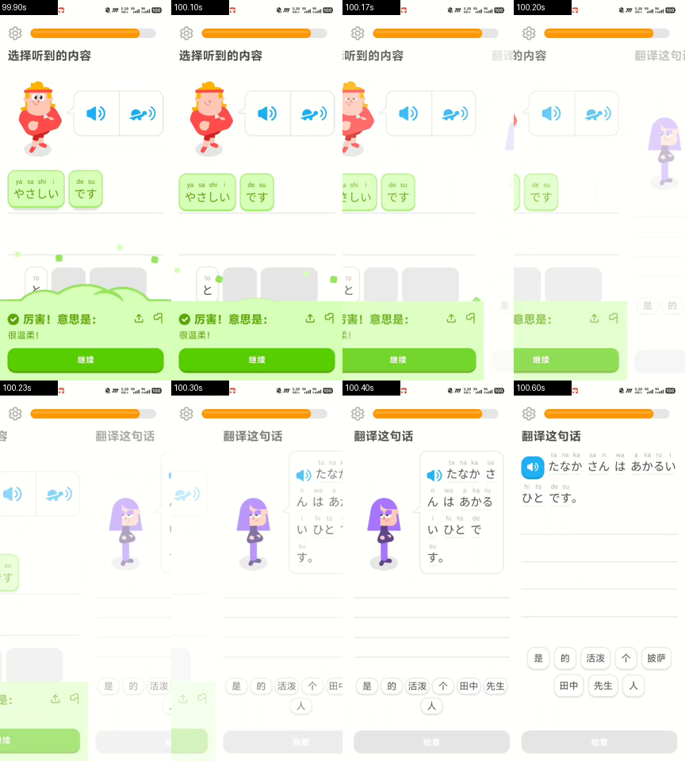
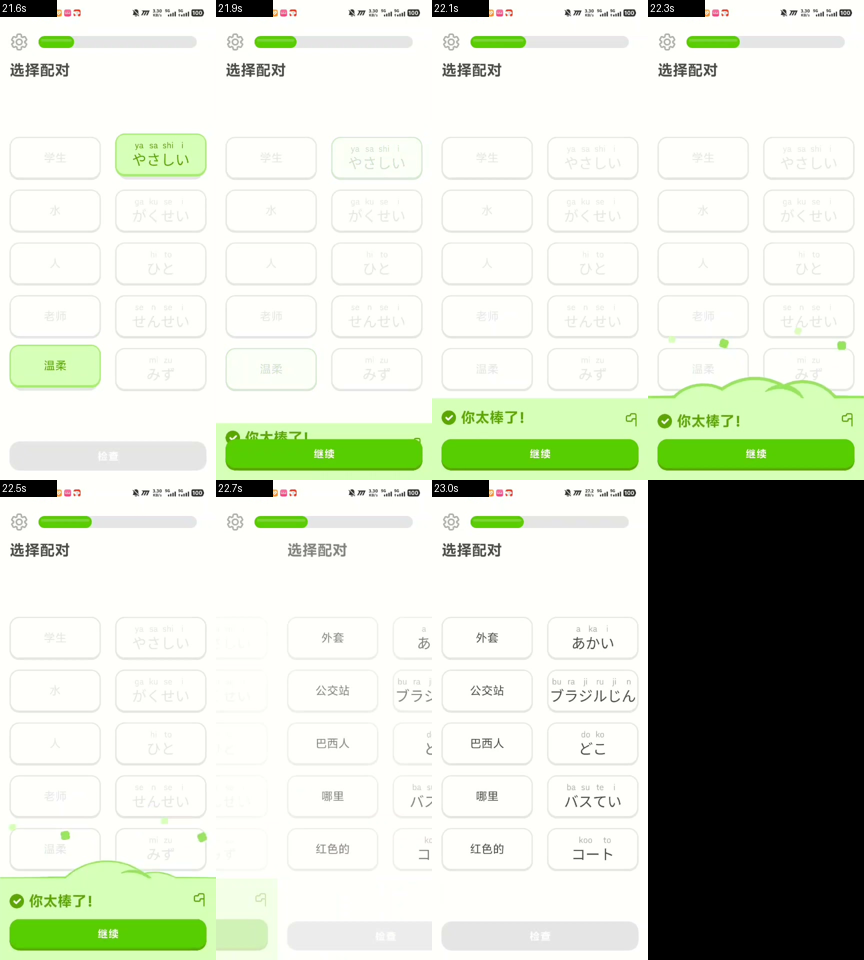
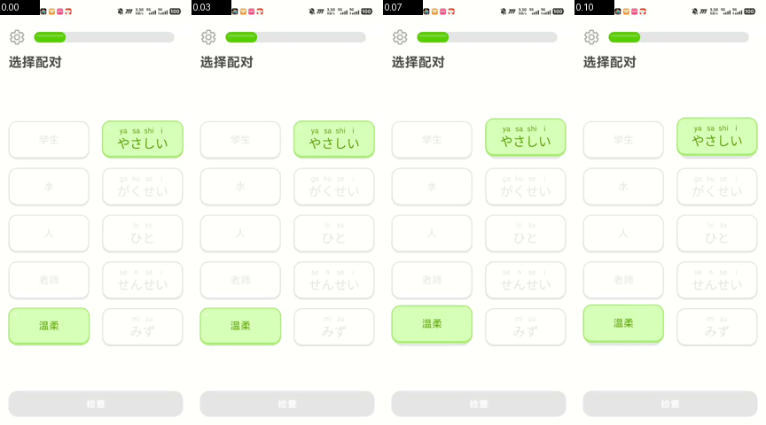
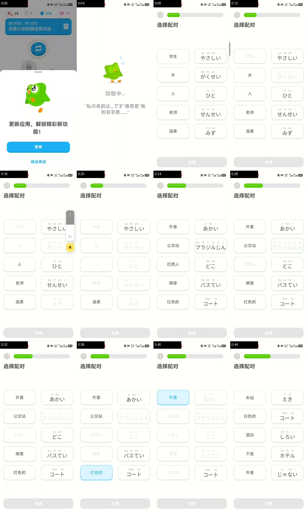
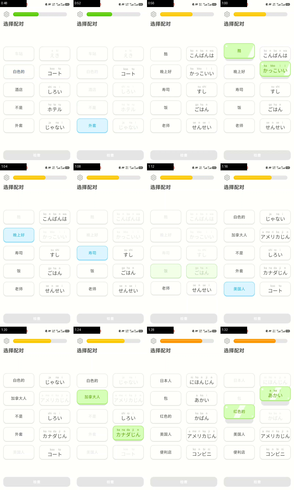

# 多邻国逐帧拆解（2026-11-07 录屏，136.9 秒）

源文件：`2026-11-07_13-48-40` 录屏，432×960，30fps，时长 136.86s，H.264 + AAC。
分析方式：`ffmpeg` 抽帧（2fps 全片 274 帧、30fps 关键段落），逐帧差分定位变化点，
再用像素采样量出尺寸与配色。

> **尺寸换算的假设**：视频宽 432px。若按 360dp 逻辑宽度换算，1px ≈ 0.833dp。
> 下面所有 dp 值都带这个假设；**比例与相对关系是可靠的，绝对值可能有 ±5% 误差**。
> 配色是从视频帧采样的，受录屏压缩影响，色值误差约 ±2。

## 关键帧

| 图 | 内容 |
|---|---|
|  | 答对那一刻的 8 帧（99.90s → 100.60s） |
|  | 反馈带放大：勾、标题、副标题、两个图标 |
|  | 带子从底部升起的 6 帧（21.55s → 21.72s） |
|  | 选项块的四种状态 |
|  | 结束三段：统计卡 → 暗场点火 → 连击战绩 |
|  | 全片概览（0:00–0:44） |
|  | 全片概览（0:48–1:32） |
|  | 全片概览（1:36–2:16） |

---

## 1. 时间轴：这一课到底发生了什么

| 时间 | 画面 | 变化幅度 |
|---|---|---|
| 0.0–3.0s | 更新弹窗 → 启动页（吉祥物 + 加载中… + 一句语法小知识） | 53（最高） |
| 3.0–21.8s | **选择配对**（第一题，5 对） | — |
| 21.87–22.33s | **答对**：进度条生长 + 绿色反馈带升起 | 12 |
| 22.4–52s | 同题型继续（第二题起） | — |
| 53.5s | 进度条由绿 → **黄**（阶段切换，不是答对反馈） | 10 |
| 73–100s | 翻译题 / 填空题，进度条继续长 | 11–18 |
| 85.5s | 进度条由黄 → **橙** | 14 |
| 100.13s | **又一次答对**（同一套反馈带，第二次出现） | 13 |
| 107–120s | 连击计数 ×8、×9 出现在顶部 | 10–18 |
| 120s | 课程结束 → **连击进行中** 页（吉祥物 + 三张统计卡） | 64 |
| 124–128s | **全屏暗场**（火焰 + 「上滑点燃你的连击！」） | 191 / 129 |
| 129–136.5s | 连击战绩页（大火苗 + 数字 1 + 一周格 + CTA） | 240 |

**声音**：这段录屏的音频轨道峰值 RMS ≈ 1/32768，即**基本静音**——录制时媒体音量是关的。
所以这份报告**不含声音设计**的结论，只能覆盖视觉与交互。

---

## 2. 答对反馈带（全片最核心的一个组件）

这是整段视频里信息密度最高、也最值得抄的一块。

### 2.1 结构

```
┌──────────────────────────────────────────────┐  ← 顶边中间微微凸起（约 7dp）
│  ✓   厉害！意思是：              ⤴   ⧉        │  ← 勾 + 标题（大） + 两个次级图标
│  很温柔！                                     │  ← 副标题（小，同色系）
│                                              │
│  ┌────────────────────────────────────────┐  │
│  │              继续                       │  │  ← 实心绿按钮，底部有 3dp 深色边
│  └────────────────────────────────────────┘  │
└──────────────────────────────────────────────┘
```

### 2.2 量出来的数值

| 项 | 实测 | 说明 |
|---|---|---|
| 带子高度 | **172dp**（中心）/ 166dp（两侧） | 占屏约 18%，从底部顶上来 |
| 顶边形状 | 中心比两侧高 **7dp** | 不是直角，是一条很浅的弧——像一张纸片被托起 |
| 底色 | `#D6FFB8` | 极浅的黄绿；和正确选项的填充色**完全一样** |
| 主按钮 | `#57CE02`，328×49dp，圆角 12dp | 底部 3dp 的 `#50AE00` 是「键程」 |
| 勾选徽章 | 23dp 实心圆 `#57CE02` + 白勾 | 与按钮同色，形成一条视觉上的「绿」 |
| 标题字号 | 约 **30sp** 粗体，色 `#5E9B12` | 比正文大一倍，是这一屏唯一的重点 |
| 副标题 | 约 **14sp**，色 `#649B26` | 同色系降一档，不是灰 |
| 左右内边距 | 左 20dp / 右 23dp | 对称但不绝对对称 |
| 右侧图标 | 分享、纠错，同色描边 | 和标题同一行，不抢位置 |

### 2.3 动效（逐帧量）

**进度条**（21.87s → 22.33s，共 0.46s）：

```
宽度(px):  73 → 86 → 96 → 103 → 107 → 111 → 113 → 112 → 111 → 110 → 108
时间(s):  21.87  .90  .93  .97 22.00  .03  .07  .10  .13  .17  .33
```

- 先冲到 **113**（超出目标 108 约 5%），再**回落**到 108 —— 标准弹簧过冲，不是线性 tween。
- 0.46 秒，中间有一段「停住」的感觉（.17 → .33 几乎不动），这是阻尼大的弹簧特征。

**反馈带**（21.88s → 22.32s）：

```
顶边 y:  942 → 847 → 820 → 804 → 799 → 798 →（停 100ms）→ 784 → 779 → 777
```

- 上升 **0.44 秒**，同样是「快速到位 → 短暂停顿 → 轻微补一下」的两段感。
- 到位后**文字不再动**：没有逐字打字机、没有缩放、没有彩色粒子（那一屏只有背景上几颗浅绿小方块，是静态装饰）。

**关键观察**：答对那一刻，**画面里同时只有两件事在动**——进度条生长、反馈带升起。
其他所有元素（题目、选项、吉祥物）都静止。这就是它「显得干净」的真正原因，不是配色好看。

---

## 3. 进度条：一条会「说话」的条

| 项 | 实测 |
|---|---|
| 轨道 | `#E5E5E5`，高 **19dp**，宽 299dp，左右各留 28dp |
| 填充 | 阶段 1 `#5ECC13`（绿）→ 阶段 2 `#F8CB10`（黄）→ 阶段 3 `#FB9910`（橙）→ 结束前 `#37EEFC`（青） |
| 左侧 | 一个齿轮（设置），与条同一行 |

**为什么换色**：换色发生在**题型切换**时（53.5s、85.5s），不是答对时。所以这条同时承担两个语义：
「我走了多远」（长度）和「现在在哪个阶段」（颜色）。对用户来说，颜色变化是「这一课进入下一段」的无声提示。

**对我们的启示**：进度条只在**真正推进**时才动，且动的时候有弹簧过冲。
我们现在的同步轨道只有静态的点，没有任何「正在推进」的运动感。

---

## 4. 选项块：四种状态，全部用「填充 + 描边」表达

| 状态 | 填充 | 描边 | 文字 | 尺寸 |
|---|---|---|---|---|
| 未选 | `#FFFFFB` | 1dp `#E8E9E4` | 墨色 | 150×68dp，圆角 12dp |
| 已选 | `#DDF5FF` | 2dp `#92D9F9` | 蓝 | 同上 |
| 正确 | `#D6FFB8` | 2dp `#A8E182` | 深绿 | 同上 |
| 已配对/失效 | `#E8E9E4` 附近 | 同色 | 灰，整块降对比 | 同上 |

- 水平间距 **27dp**，垂直行距 **20dp**。
- 两列固定：左列中文，右列假名（假名上方还有一行罗马音，字号极小）。
- 选中时**只有描边和填充变**，尺寸完全不变——不会让整屏跳一下。

---

## 5. 底部主按钮：3D 键程

| 状态 | 颜色 | 说明 |
|---|---|---|
| 禁用 | `#E7E7E7` + 灰字 | 「检查」，用户没选够词时 |
| 可用 | `#57CE02` + 白字 | 同一个位置，只换颜色 |
| 按下 | 下沉（推断，录屏里没捕捉到按下帧） | 底部 3dp 的 `#50AE00` 就是给它沉的 |

**这是全片最容易被忽略、但最影响手感的一处**：按钮不是平的色块，它有一条更深的底边。
按下去时整颗键往下沉 3dp，视觉上「按进桌面」。我们 App 的「已取」按钮刚刚补上了这一条。

---

## 6. 结束仪式：三段，而且**要求用户参与**

| 段 | 时长 | 内容 |
|---|---|---|
| 连击进行中 | ~4s | 吉祥物（哭着冲刺的表情）+ 蓝 CTA「领取经验」+ 三张统计卡（黄=经验 40、蓝=连击 ×10、绿=时间 0:24），卡片带彩色描边和闪光 |
| **暗场仪式** | **~4s** | 全屏 `#202F34` 深色 + 火焰光晕 + **「上滑点燃你的连击！」** ——必须做一个手势才能继续 |
| 连击战绩 | ~7s | 大火苗 + 吉祥物 + 巨大数字「1」+ 「连击战绩」+ 一周格（今天打勾）+ CTA「我会回来的！」 |

**这三段的设计逻辑**（我的判断）：

1. 先给**总量**（三张卡：经验、连击、时间），让这一课的产出可见；
2. 再让用户**亲手做一个动作**（上滑点燃）——不是看动画，是参与仪式。这一步把「App 给我的奖励」变成「我点亮的」；
3. 最后给**长期身份**（连击天数 + 一周格），把今天和以后的每一天连起来。

**这是它和普通「完成页」最大的区别**：普通 App 是「恭喜完成，返回首页」；多邻国要求你花 4 秒做一个动作，
而这 4 秒的注意力，就是它把一次使用变成习惯的地方。

---

## 7. 它「显得高级」的六个可复用原则

按可迁移性排序：

1. **一次只让两件事动**。答对时只有进度条 + 反馈带在动。我们经常让整屏都动，反而显得廉价。
2. **弹簧，不是 tween**。进度条过冲 5% 再回落，0.45 秒。线性动画看起来像「加载」，弹簧看起来像「有重量」。
3. **颜色只做语义，不做装饰**。绿=对，黄/橙=阶段，蓝=可选动作，灰=失效。全片没有一个渐变背景。
4. **同一色系降一档做副标题**。副标题不是灰色，是主色的浅版本（`#5E9B12` → `#649B26`）。这比灰色更有「一家人」感。
5. **按钮有厚度**。3dp 底边 + 按下下沉。这一条的成本极低，收益极高。
6. **奖励要人参与**。暗场里那个上滑，是整个流程里唯一需要「主动使劲」的地方。

---

## 8. 映射到卡皮巴拉：抄什么、不抄什么

### 值得抄（按优先级）

| 原则 | 落到我们哪一屏 | 状态 |
|---|---|---|
| 反馈带（浅色底 + 勾 + 大标题 + 副标题 + 实心 CTA） | 现场模式「已取」成功 | **已做**（`UndoBar` 改成浅绿带） |
| 3D 键程 | 「已取」按钮 | **已做**（4dp 底边 + 下沉 3dp） |
| 弹簧过冲 | 现场模式换件、同步进度 | 部分（换件用弹簧，同步轨道还没动效） |
| 四种块状态（未选/已选/正确/失效） | 取件卡、同步轨道通道 | 未做 |
| 颜色只做语义 | 全局 | 基本做到 |
| 同色系降一档做副标题 | 反馈带、空态 | 未统一 |

### 不该抄

| 多邻国的做法 | 为什么不适合我们 |
|---|---|
| 连击 / XP / 排行榜 | 取件工具一周用几次，做「每日打卡」是骚扰不是激励 |
| 暗场 + 上滑仪式 | 用户站在柜机前，手上拿着手机、可能要腾出手拿包裹。**多一步手势就是多一次失败** |
| 吉祥物哭泣/催促 | 我们的吉祥物只出现在「做完了」的时刻，不做情绪施压 |
| 一屏只放一道题 | 我们的首页必须一次给全所有待取件——这是「作战面板」和「课程」的根本差别 |

---

## 9. 如果要继续做，下一步最值的三件事

1. **同步轨道的进度感**：现在只有静态点。给「正在同步」的通道加一条 2dp 的细进度（弹簧过冲），
   让「在动」这件事本身可被看见。成本：约 40 行。
2. **取件卡的四种状态**：把多邻国的「未选/已选/正确/失效」映射到「待取/临期/已取/已退休」，
   统一用「填充 + 描边」表达，不再混用色条和文字标签。成本：中等，但会让首页整齐很多。
3. **副标题统一到同色系降一档**：把现在散落的 `InkMuted` 副标题，在带色底的卡片里换成主色的浅版本。
   成本：低。

---

## 附：分析方法

```bash
# 全片 2fps 抽帧 + 逐帧差分找变化点
ffmpeg -i in.mp4 -vf fps=2 -q:v 2 frames/f_%03d.jpg

# 关键段落 30fps 抽帧（量动效曲线）
ffmpeg -ss 21.4 -t 1.4 -i in.mp4 -vf fps=30 -q:v 2 bar2/q_%02d.jpg

# 像素采样（配色与几何）
python: PIL Image.getpixel / Counter
```

差分曲线里 >3 的帧才可能是「用户能看见的变化」；<3 基本是压缩噪声。
本报告所有时间点都来自这条曲线，不是目测。
